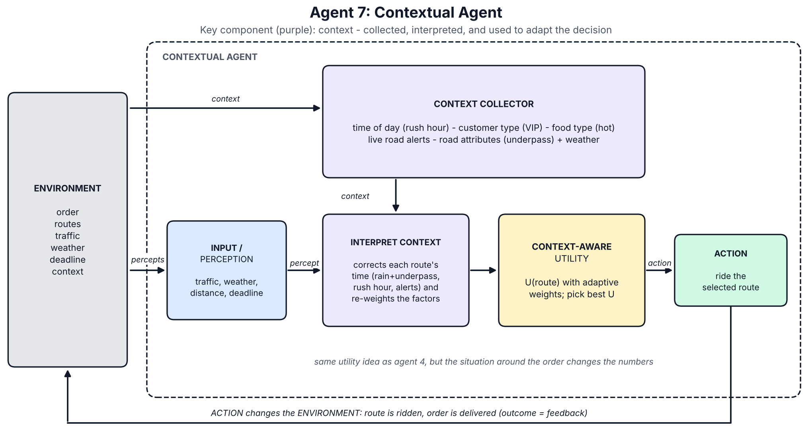

<div align="center">

# Smart Food Delivery Agents

**A Python simulation comparing seven intelligent agents as they choose delivery routes under changing conditions.**

**Built with**

[](https://www.python.org/)
[](https://developer.mozilla.org/docs/Web/JavaScript)
[](https://matplotlib.org/)
[](#requirements)

**Agent architectures**

[](#the-seven-agents)
[](#the-seven-agents)
[](#the-seven-agents)
[](#the-seven-agents)
[](#the-seven-agents)
[](#the-seven-agents)
[](#the-seven-agents)

[](#benchmark-snapshot)

[Explore the dashboard](dashboard/smart_food_delivery_dashboard.html) ·
[View the report](report/Assignment1_Agent_Based_Modeling_SherAliSaleem.pdf)

</div>

---

## Overview

This project models a food-delivery environment and compares seven agent designs, from fixed reflex rules to a learning agent and a context-aware agent. Each agent receives information about an order and available routes, selects a route, and is evaluated against what actually happens in the simulation.

The environment includes traffic, weather, deadlines, tolls, road alerts, missing live traffic readings, and hidden travel-time effects. The separation between what an agent can perceive and the simulator's ground truth makes it possible to study decisions under incomplete information.

## At a glance

- **7 agent architectures** implemented behind a shared interface.
- **3 repeatable test situations** for comparing decisions side by side.
- **1,000 unseen benchmark deliveries** generated with a fixed seed.
- **600 simulated training deliveries** used to train the learning agent.
- **Interactive HTML dashboard**, architecture diagrams, saved results, and the assignment report.

## Benchmark snapshot

Results from the saved benchmark run (`seed = 2026`):

| Agent | On time — all | On time — urgent | Average time | Average cost |
|:--|--:|--:|--:|--:|
| 1. Simple Reflex | 93.2% | 83.1% | 16.5 min | Rs 44 |
| 2. Model-Based Reflex | 94.4% | 85.7% | 16.1 min | Rs 46 |
| 3. Goal-Based | 88.0% | 86.6% | 18.9 min | Rs 33 |
| 4. Utility-Based | 94.0% | 85.3% | 16.4 min | Rs 38 |
| 5. Learning (trained) | 95.0% | 87.6% | 16.2 min | Rs 40 |
| 6. Hierarchical | 94.5% | 87.0% | 16.3 min | Rs 38 |
| **7. Contextual** | **96.5%** | **92.2%** | **15.6 min** | Rs 42 |
| Oracle (hindsight) | 96.8% | 92.2% | 15.3 min | Rs 53 |

The benchmark has 307 urgent deliveries. The oracle is a reference that chooses with knowledge of each route's actual outcome; it is not an agent with information available at decision time. These figures describe this seeded simulation, not a general real-world performance guarantee.

## The seven agents

| # | Agent | Decision approach |
|--:|:--|:--|
| 1 | **Simple Reflex** | Applies fixed condition-action rules to the current percept. |
| 2 | **Model-Based Reflex** | Uses internal state and remembers the last known traffic reading when a feed is unavailable. |
| 3 | **Goal-Based** | Predicts route ETAs and chooses the first route that meets the delivery deadline. |
| 4 | **Utility-Based** | Scores all routes by time, distance, traffic, and cost, with a penalty for lateness. |
| 5 | **Learning** | Learns route- and condition-specific travel-time factors from delivery outcomes. |
| 6 | **Hierarchical** | Breaks delivery into ordered subgoals and selects a route within a time budget. |
| 7 | **Contextual** | Adjusts travel-time estimates and decision priorities using weather, rush hour, customer, food, and road-alert context. |

### Architecture diagrams

The diagrams are generated from the project code and included for quick reference:

<div align="center">



*Agent 7 — Contextual Agent*

</div>

See all seven diagrams in [`food_delivery_agents/diagrams/`](food_delivery_agents/diagrams/).

## Quick start

### Requirements

- Python **3.10 or newer**
- No third-party packages are required to run the simulation.
- `matplotlib` is needed only if you want to regenerate the diagrams.

### Run the tests

From the project root:

```bash
cd food_delivery_agents
python run_tests.py
```

To also print each agent's reasoning and hierarchical plan:

```bash
python run_tests.py --why
```

### Run the benchmark

```bash
python benchmark.py
```

Both commands print their results and update files in `food_delivery_agents/results/`. The random seeds are fixed, so runs are repeatable.

### Open the dashboard

Open [`dashboard/smart_food_delivery_dashboard.html`](dashboard/smart_food_delivery_dashboard.html) in a web browser.

### Regenerate the diagrams (optional)

Install the optional plotting dependency, then run the diagram generator from the agents directory:

```bash
python -m pip install matplotlib
python diagrams_5_7.py
```

The generator redraws all seven PNG diagrams into `food_delivery_agents/diagrams/`.

## Project structure

```text
.
├── dashboard/
│   └── smart_food_delivery_dashboard.html
├── food_delivery_agents/
│   ├── agent1_simple_reflex.py ... agent7_contextual.py
│   ├── base.py                 # shared agent interface and utility function
│   ├── environment.py          # percepts, routes, scenarios, and simulation
│   ├── run_tests.py            # three standard scenarios
│   ├── benchmark.py            # seeded random-delivery benchmark
│   ├── diagrams_1_4.py         # diagram components for agents 1-4
│   ├── diagrams_5_7.py         # diagram components and generator for all seven
│   ├── diagrams/               # generated agent architecture PNGs
│   └── results/                 # saved benchmark, logs, and test results
└── report/
    ├── Assignment1_Agent_Based_Modeling_SherAliSaleem.pdf
    └── Assignment1_Agent_Based_Modeling_SherAliSaleem.docx
```

## Results and report

The `food_delivery_agents/results/` folder contains:

- `test_results.txt` and `test_results.csv` — decisions and outcomes for the three standard scenarios.
- `decision_log.txt` — explanations produced by the agents.
- `learned_factors.txt` — travel-time factors learned by Agent 5.
- `benchmark.txt` — results from the 1,000-delivery benchmark.

The assignment report is available as [PDF](report/Assignment1_Agent_Based_Modeling_SherAliSaleem.pdf) and [editable Word document](report/Assignment1_Agent_Based_Modeling_SherAliSaleem.docx).

## How the simulation works

1. The environment creates a delivery situation and exposes a **percept** to an agent. A live traffic reading can be missing.
2. The agent observes the percept and chooses a route, optionally using state or learned knowledge.
3. The simulator evaluates that decision against the **true situation**, including hidden delays and road effects.
4. During training, the learning agent uses delivery feedback to update its travel-time estimates. The benchmark uses a separate fixed seed to generate unseen situations.

The test scenarios are useful for inspecting specific cases; the larger seeded benchmark gives a broader, but still simulation-specific, comparison.

## License

No license has been specified. If you publish this repository, add a license that matches how you want others to use the project.
